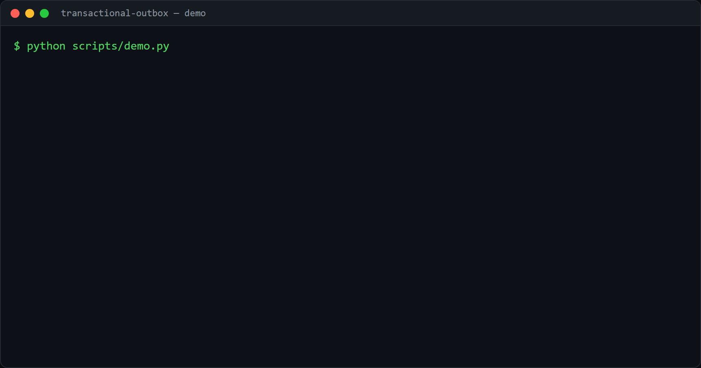

# transactional-outbox

The **transactional outbox** pattern, the standard fix for the dual-write
problem, in a small, tested, dependency-free form (stdlib `sqlite3`).

## Demo



## The problem

A service often has to do two things: change its database and tell another
system about it (publish an event, call an API). Those are two separate writes.
If the process crashes after the database commit but before the event is sent,
the two sides are out of sync forever, and there is no transaction that spans
both.

## The pattern

Write the business change **and** an `outbox` row in **one database
transaction**. Either both commit or neither does. A separate **relay** reads
the outbox rows and publishes them, marking each `sent` only once publishing
succeeds.

```
apply_change ─┐  (one transaction)
              ├─► business row
              └─► outbox row  ──►  relay ──► publish ──► consumer
```

- **Atomic.** If the business rule fails (here, an overdraft), the whole
  transaction rolls back, so there is never an event for a change that did not
  happen, and never a change without its event.
- **At-least-once.** If the broker is down, `publish` raises, the event stays
  `pending`, and the next relay run retries it. Nothing is lost.
- **Idempotent consumer.** Because an event can be delivered more than once, the
  consumer records the ids it has handled and skips duplicates, so the effect
  happens exactly once.

This is the pattern catalogued at
[microservices.io](https://microservices.io/patterns/data/transactional-outbox);
Debezium implements the same idea by tailing the database log.

## Use it

```python
from outbox import OutboxStore, relay_once, IdempotentConsumer

store = OutboxStore("app.db")
store.apply_change("acct-1", 100, "money_deposited")   # change + event, atomic

relay_once(store, publish=my_broker.send)              # deliver pending events

consumer = IdempotentConsumer("consumer.db")
consumer.handle(event, action=apply_to_read_model)     # runs once, even on retries
```

```bash
pip install -e .
python scripts/demo.py
```

## Tests

```bash
pip install -e ".[dev]"
pytest
```

Covers atomic write, rollback of both on a failed change, relay delivery (and no
redelivery), the broker-down retry path, and consumer idempotency.

## Limitations and next steps

- Single-process relay with a simple `pending -> sending -> sent` claim. A real
  deployment runs several relays, so it needs a lease/`locked_at` with a timeout
  to recover events stuck in `sending` after a crash.
- Polling relay; the log-tailing (CDC) variant with Debezium avoids the poll.
- Next: a dead-letter status after N failed attempts, and ordering guarantees per
  aggregate.

## License

MIT.
